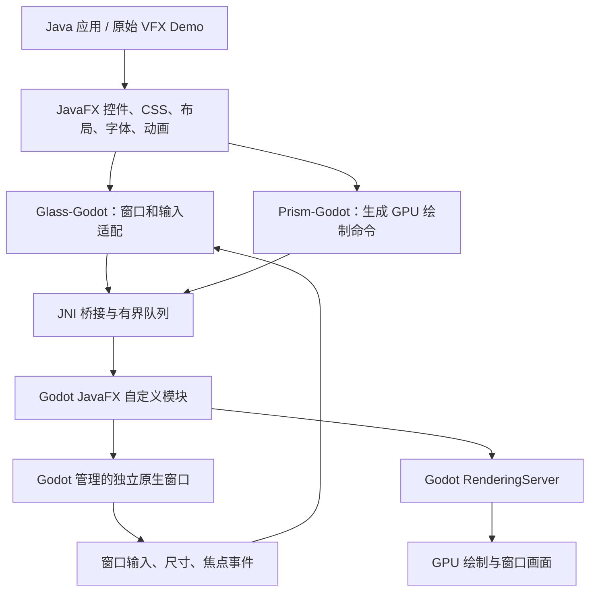

# Godot 承载 JavaFX：架构说明

## 这个项目做什么

JavaFX 是 Java 的桌面界面工具：程序用它创建按钮、文字、表格和窗口。Godot 是带窗口、输入和 GPU 渲染能力的引擎。本项目保留 JavaFX 的控件与使用方式，把底层窗口和绘制交给 Godot。

例如，一段普通 JavaFX 程序创建一个按钮并注册点击回调。按钮的布局、文字、CSS 和回调仍由 JavaFX 处理；按钮画面最终由 Godot 提交给 GPU，点击则从 Godot 的窗口输入返回 JavaFX。VFX 是用来验证这套运行时的真实 JavaFX 控件库和 Demo，不是另一套渲染引擎。

当前平台是 Windows x64 和 macOS arm64（Apple 芯片；`mobile` 渲染器在 Windows 上走 Vulkan、在 macOS 上走 Metal，另有 OpenGL 兼容渲染器）。Media 音视频在范围内；WebKit 网页组件和 3D 不在当前范围。主要功能已实现，但这不表示兼容全部 JavaFX 应用。具体证据和缺口以 [验收状态](acceptance-status.md) 为准。

## 先认识这些名字

| 名称 | 在这里的意思 |
| --- | --- |
| Stage | 一个 JavaFX 窗口；主 Stage 使用 Godot 的主窗口，次级 Stage 使用独立的系统窗口 |
| Scene / Node | 窗口里的界面树；Scene 是容器，Node 是按钮、文字、形状或一组子节点等元素 |
| Glass | JavaFX 对接操作系统的内部层：窗口、输入、屏幕、光标、剪贴板等 |
| Prism | JavaFX 的内部绘图层：把界面转换为纹理、形状、着色器和绘制操作 |
| Glass-Godot / Prism-Godot | 本项目分别为上述两层实现的 Godot 后端 |
| Shader | 在 GPU 上运行的小程序，例如改变颜色、计算阴影、混合图像 |
| 纹理 / 渲染目标 | 纹理是 GPU 可采样的图像；渲染目标是可以先画进去、再用来合成的图像 |
| Viewport / SubViewport | Godot 中负责生成一幅场景画面的区域；可对应窗口，也可在后台生成纹理 |
| RenderingServer | Godot 接收绘制和 GPU 资源操作的服务；不是需要另行启动的网络服务器 |
| JVM / JNI | JVM 运行 Java 代码；JNI 是本项目 C++ 宿主与 JVM 之间的调用接口 |
| Pulse | JavaFX 的一次界面更新机会，用于动画、CSS、布局和准备绘制；不等于显示器实际显示一帧 |

## 谁负责什么

运行 `java -jar app.jar` 时，JavaFX 从应用 JAR 加载 Godot 引擎库。引擎在当前 Java 进程中创建管理窗口和绘制的节点 `JavaFXHost`。

Godot 负责主循环、系统窗口、设备输入以及 GPU 工作。JavaFX 继续负责按钮怎么布局、文字怎么排版、CSS 怎么解释、事件回调执行在哪个 Java 线程。我们没有重写 JavaFX 的上层控件，也没有把原始 VFX 业务代码改成 Godot UI。

## 一个按钮如何出现在屏幕上

1. 应用创建 Stage、Scene 和 Button。Glass-Godot 把窗口请求交给 Godot；请求携带窗口身份，后续绘制和输入都能找到对应窗口。
2. Godot 的帧调度为 JavaFX 提供更新机会。JavaFX 在自己的应用线程上处理动画、CSS 和布局，确定按钮的位置、大小和内容。
3. JavaFX 的渲染线程复用 Prism 的图形、文字和着色器逻辑。Prism-Godot 将纹理更新、绘制状态和顶点等操作打包成命令。
4. JNI 把命令复制到宿主拥有的存储中，校验格式、长度和资源身份，再进入有界队列。原生代码不能长期使用失去保护的 Java 内存指针。
5. Godot 主线程消费命令，操作 Godot 对象并调用 RenderingServer。Godot 根据渲染模式安排实际 GPU 工作。
6. 界面可以先画进离屏目标，再合成到对应窗口。宿主区分“命令已接收”和“本轮渲染已完成”，之后才回收不再被使用的临时资源。

这不是每帧把整个 JavaFX 窗口截图到 CPU，再上传给 Godot。图片、字体/形状掩码和解码后的视频平面仍可能需要上传；这是绘制素材的传输。测试也会主动读回 GPU 图像检查像素，但读回不是普通界面的持续显示路径。

## 点击如何回到 Java 代码

Godot 收到系统窗口事件后，记录窗口身份、坐标、按键或输入文本。Glass-Godot 将它交给 JavaFX 的事件线程，再由 JavaFX 找到被点击的控件并调用应用回调。

窗口身份不能丢失：两个重叠窗口中的相同坐标代表不同对象。尺寸、焦点、关闭和输入法状态也按窗口维护。对嵌入的 GodotView，输入还需要经过界面变换和焦点检查，转换成对应 SubViewport 的坐标。

普通按键与输入法不是同一件事。输入法还有未提交的组合文本、候选位置、提交和取消。已有注入测试不等于验证了真实中文输入法候选窗口或真实触摸设备。

## 拖放与系统功能

系统剪贴板让不同程序交换复制的内容。当前适配层支持文本、HTML、RTF、URL、图片、文件列表和约定名称的自定义格式；例如 URL 使用 Unicode 字符串保存中文地址。写入前先检查数据是否合法，再替换系统内容，避免错误参数清掉原有内容。系统互操作测试直接覆盖剪贴板并检查原生对端读取的数据。

拖放是“拖出数据 → 判断目标是否接收 → 放下或取消”的过程，不只是按住鼠标移动。当前应用内拖放使用单独的数据容器，支持在同一窗口或两个 Stage 之间传递内容；它不会覆盖用户的系统剪贴板。JavaFX 负责触发控件的拖放回调，适配层负责传递坐标、协商复制/移动/链接操作，并在完成或取消时清理状态。跨应用拖放已接入 Windows 的 OLE 数据交换机制：它让两个进程协商要传递的格式及是否接收（macOS 上使用系统的 Cocoa 拖放协议完成同样的事）。当前真实辅助窗口测试已验证双向文本、URL、文件、自定义数据和拖动图像；这不代表所有外部应用都已验证。

外部拖放可能在 Java 程序退出时到达。为避免回调进入已经销毁的 Java 运行环境，适配层用同一把锁协调“允许回调进入”和“关闭入口”：已进入的回调先完成并释放临时数据，退出线程随后关闭入口，再释放桥接资源。入口关闭后的拖放直接拒绝。这里的锁只保护拖放回调，不参与逐帧绘制。

文件对话框、Robot 和剪贴板也属于 Glass 的系统接口。它们不必由 Godot 绘制：当前文件对话框使用 Windows 原生界面，并关联 Godot 管理的实际窗口。例如子窗口打开文件选择器时，适配层会暂时禁止操作它和它的上级所属窗口，关闭选择器后恢复；等待选择期间仍处理 JavaFX 事件和动画。Windows 对话框在单独的系统线程运行，Godot 宿主退出时负责协调关闭。目前一次只允许打开一个文件或目录选择器。macOS 上同一套“提交请求、等待结果、可取消”的约定由系统的 NSOpenPanel/NSSavePanel 面板承担。Robot 是 JavaFX 提供的模拟键鼠、读取屏幕像素的工具。在 Windows 上它通过 Windows 系统接口发送输入和截图，在 macOS 上改用 CoreGraphics 系统接口；两者都把 JavaFX 的逻辑坐标转换成显示器像素坐标，例如 2× 缩放下，20 个界面单位的截图可以保留为 40 个实际像素。这个按需截图功能与普通控件的 GPU 绘制是不同路径，不参与每帧显示。这些功能的实现与验证情况见验收清单。

## Stage 与 GodotView 的区别

**Stage 是窗口。** 主 Stage 复用 Godot 根窗口；次级 Stage/Popup 由 Godot 创建独立原生窗口，可以出现在主窗口边界之外。它们保留各自的尺寸、焦点、所有者和生命周期。模态窗口会限制相应窗口的交互。以前把 Stage 画在旧窗口里的方案已经被替代，旧测试见 [logical-windows.md](logical-windows.md)。

**GodotView 是界面里的控件。** 它加载一个 Godot 2D 场景，在 SubViewport 中渲染，然后直接把 GPU 纹理参与 JavaFX 界面合成。它可与按钮、文字同屏，跟随布局改变大小，并受父节点裁剪、透明度和变换影响。它不应该为自己创建一个独立系统窗口。

透明 Stage 使用透明的 Scene 填充。Java 启动的无工程宿主在创建窗口系统前启用逐像素透明；应用显式加载的工程需要在工程设置中启用该能力。

## 线程为什么要分开

引擎默认创建一棵空场景树，随后用主 Stage 设置根窗口。需要 GodotView 自定义场景的应用可以在 JAR 中携带场景资源包。Windows 在专用线程处理窗口事件并逐帧运行。macOS 库入口把这项工作交给 AppKit 主线程，实机验证见 TESTS.md 的待办。JavaFX 保有自己的应用线程和渲染线程。[单 JAR 规格](godot-library-spec.md)

下表是职责，不保证每个角色在所有运行模式中都是一条独立线程。

| 角色 | 允许负责的工作 |
| --- | --- |
| Godot 主线程 | 窗口和场景对象的创建/修改，宿主循环，消费 Java 请求 |
| JavaFX Application Thread | Java 应用事件回调、控件状态、动画、CSS、布局 |
| JavaFX 渲染线程 | Prism 绘制准备、纹理与渲染资源操作、命令编码 |
| Godot 渲染执行 | RenderingServer 后端和 GPU 提交；宿主只支持 `safe`，在 Godot 主线程执行 CPU 侧渲染工作 |

JavaFX 渲染线程不能直接修改 Godot 的 Node。跨线程通过队列和完成通知协调；队列满时施加背压，停止时唤醒等待方，避免无限积压和永久等待。Godot 主线程也不能一边等待 Java 回调，一边阻止该回调所等待的窗口/渲染请求被处理，否则会死锁。

保留这些边界的目的，是让普通 JavaFX 应用继续拥有熟悉的线程语义，同时不违反 Godot 对窗口和场景访问的要求。

等待输入的后台线程也需要知道 JavaFX 是否已经退出：Godot 宿主可以继续运行，不能把宿主关闭当成它唯一的退出条件。Glass 退出时设置停止标记；原生输入等待最多持续一秒，返回后线程检查标记并结束，已排队的输入任务也不再派发事件。退出过程不在 JavaFX 应用线程上等待这一秒。 静态桥接对象还保存过一个“收到外部拖入时调用应用”的回调；退出时也要解除它，否则这个回调仍会持有旧应用及其关联对象，即使接收线程已经结束。

## Effect、Node Shader 和视频怎样接入

- **JavaFX Effect**：例如模糊、阴影、颜色调整。复用 JavaFX 效果处理结构，将生成的效果着色器映射到 Godot，必要时使用离屏目标。它与直接写 Godot Shader 是不同入口。
- **GodotShaderEffect**：给指定 Node 或整棵子树加 Godot CanvasItem Shader。先得到该节点输入，再运行着色器，并保留剪裁、透明度和图层顺序；不是只能给整个窗口统一加效果。当前支持有明确限制，见 [node-shaders.md](node-shaders.md)。
- **MediaView**：原生 Media 库负责解码，视频平面交给 Prism-Godot。YUV 平面按单通道 R8 上传，由 GPU 着色器转成最终颜色，避免先在 Java 中扩展成四通道。解码器到 GPU 仍有上传，不是零拷贝。播放器销毁时释放解码器，并在渲染线程释放缓存的 GPU 平面。

## 资源如何安全销毁

一张纹理可能已经被前面的绘制命令引用。此时后续更新或销毁不能让前面的命令突然看到新内容，或者访问已释放的资源。因此宿主记录资源版本和引用，延后释放仍在使用的版本。 绘制、结束离屏 pass、窗口合成和资源回收按顺序执行；不能把“命令已入队”当成“画面已经显示”。

资源句柄含有槽位和代次；同一个槽位被重新使用时代次增加，旧命令不能误认成新资源。队列中的资源校验是事务式的：非法批次不能只执行一半并污染后续状态。窗口关闭、应用异常、显式停止和正常退出都需要清理与唤醒路径。

“最终资源计数为零”仅说明所统计的宿主资源已清理。Java 堆、原生解码器、驱动缓存和整个进程内存还要分别观察，不能只用一项计数宣布没有泄漏。

## 如何理解验证结果

JavaFX 宿主只保留 Viewport＋safe：通过 Godot 视口生成纹理，并在 Godot 主线程提交渲染工作。JavaFX 应用线程和 Prism 渲染线程仍独立运行；GPU 仍可异步执行。此前自行实现的 RD-direct 绘制路径、着色器翻译器和 separate 专用适配已删除。Godot 原生 RenderingDevice（图形设备抽象）仍保留，Vulkan/mobile 的 Viewport 渲染和纹理区域上传继续使用它。OpenGL 兼容渲染器也可用于同一 Viewport 路径。宿主会拒绝 separate 模式；构建和运行不再提供 RD 选择开关。

构建成功证明代码能编译；测试断言证明特定路径；GPU 截图证明读回的画面；原生窗口/真实输入还需要对应的系统级验证。帧率报告也要区分 JavaFX Pulse、MediaView 绘制、Godot 合成和物理显示器刷新，不能把数字混用。

宿主有一个可关闭的帧率回退：没有应用限速、窗口同步开启且持续偏慢时，可以尝试按显示器刷新率由 CPU 控制节奏。低速本身不证明原因。Java 结束或宿主停止时，回退改动会被撤销；如果应用后来把帧率改成另一个值，则保留这个新值。具体条件与测量限制见 frame-benchmark.md。

当前有普通控件、Effect、独立窗口、GodotView、Node Shader、35 页原始 VFX、Media 控制和 1080p60 的测试证据，也有有界的资源压力测试。真实设备输入、物理音画同步、混合 DPI 及部分 Glass 接口仍有缺口。具体数字不在本架构文档复制，避免每次测试更新造成多处矛盾；请查 [acceptance-status.md](acceptance-status.md)。

## 从说明找到代码

| 要理解或修改的部分 | 入口 |
| --- | --- |
| JVM 启动、宿主生命周期 | `native/godot_modules/javafx/javafx_host.*` |
| 原生窗口注册与操作 | `native/godot_modules/javafx/javafx_host_windows.cpp`（Windows）、`javafx_host_macos.mm`（macOS）、`javafx_native_window.*` |
| 命令和资源合法性 | `native/godot_modules/javafx/frame_protocol.h`、Java `GodotRenderCommands` |
| 原生纹理、离屏绘制、窗口合成 | `javafx_render_surface.*`、`javafx_render_target.*`、`javafx_window_surface.*` |
| JavaFX 系统接口 | `jfx/modules/javafx.graphics/src/main/java/com/sun/glass/ui/godot/` |
| JavaFX GPU 绘制后端 | `jfx/modules/javafx.graphics/src/main/java/com/sun/prism/godot/` |
| 调度与 Java 桥接 | `jfx/modules/javafx.graphics/src/main/java/com/sun/javafx/tk/godot/` |
| 视频帧与播放器 | `jfx/modules/javafx.media/`、Prism-Godot 的媒体纹理路径 |

更多协议和生命周期细节分别在 [bridge-protocol.md](bridge-protocol.md)、[glass-godot.md](glass-godot.md)、[prism-godot.md](prism-godot.md)。构建运行看根目录 [AGENTS.md](../AGENTS.md)，按改动选测试看 [TESTS.md](../TESTS.md)。历史决策与实验保存在 [progress.md](progress.md)，不作为当前架构的另一套定义。

### Shader、材质和网格如何安全复用

Shader 是 GPU 上执行的程序，材质则把 Shader 与本次绘制的参数、纹理组合起来。
每个离屏目标缓存最多 64 个 Shader 和 256 份材质。源码或参数的哈希只是帮助查找的
数字，不是唯一身份；命中后仍比较完整内容。材质还会检查引用的纹理是否仍然有效。
超过缓存容量的对象仍按当前绘制的生命周期保留，不会为了限制缓存而提前销毁正在
使用的资源。这些限制不等于整个进程或 GPU 内存的上限。

Mesh 是保存顶点和颜色等数据的图形对象。离屏目标共享一个网格内容缓存，最多
4096 项、48 MiB 输入数据。缓存按最近使用顺序淘汰旧条目；已经记录的绘制槽另行
持有需要的 Mesh，因此缓存淘汰不会让排队中的图形消失。

绘制槽也会记住设置过的 Shader 参数。例如上一轮显式设置红色，下一轮省略颜色，
就应采用 Shader 默认值。参数名减少或换用 Shader 时，宿主重建该槽的绘制对象，
让 Godot 使用正确默认值；其他情况继续复用。这同时保留了性能与画面正确性。

纹理更新遵循同样的所有权规则：已经被绘制引用的红色纹理收到蓝色更新时，会创建
新版本，旧绘制仍看到红色。尚未被引用的纹理可以原地更新，并只上传变化区域。
窗口、纹理和绘制对象的操作都在 Godot 主线程进行；JavaFX 线程通过有界命令队列
提交请求，不直接修改这些对象。

### 输入记录为什么也需要版本一致

宿主把一次鼠标或键盘操作写成一条固定长度的数据记录，Java 端再把它还原成
JavaFX 事件。当前窗口输入记录另有两个字段保存系统的滚轮设置，例如每次滚动
几行、是否按页滚动。它们分别存放，避免把两个数字挤进一个字段后丢失信息。
这种内部格式改变时，Godot 宿主和 JFX SDK 必须一起重建；新的接口名称会让
版本不匹配时明确报错，防止把坐标误当成其他事件数据。

输入框还在组合输入法文字时，点击另一个控件需要先完成旧输入框的文字。此时
JavaFX 只提前处理该窗口的组合文本与文字提交，不提前处理队列里的鼠标释放或
普通按键。这样一次点击仍按“按下、释放”的顺序完成；应用主动打开模态窗口
并等待用户操作的事件循环仍然可用。

## 启动时的窗口

VFX Demo 在 Java 中选择启动窗口样式，先隐藏 Godot 的原生窗口，等 JavaFX 第一次调用 `show()`，
再在这个应用窗口内显示 Godot logo。logo 至少显示一秒，而且必须等到
JavaFX 第一帧绘制完成，才切换为应用内容；后续窗口不重复显示。
这由宿主完成，应用不必创建额外的欢迎窗口。
`run-vfx-demo.ps1 -NoGodotLogo` 可以直接从准备好的应用画面开始显示。
普通应用默认在第一帧就绪后直接显示 Stage。
开关、生命周期和验证命令见 [启动窗口](startup-window.md)。
